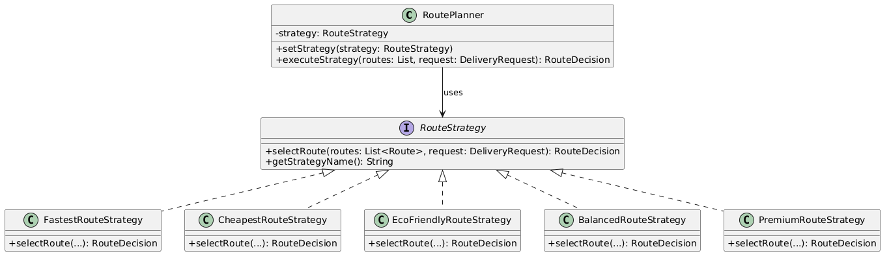

# Assignment 5: Smart Delivery & Route Optimization Engine

## 1. Core Architecture & Strategy Pattern

- Problem: Avoid if-else or switch monoliths when selecting route optimization algorithms, adhering to the Open/Closed Principle.
- Context: RoutePlanner (in delivery.planner) maintains a reference to a RouteStrategy abstraction and delegates route selection to it.
- Strategy Interface: RouteStrategy (in delivery.strategy) defining selectRoute(...) and getStrategyName().
- Concrete Strategies: FastestRouteStrategy, CheapestRouteStrategy, EcoFriendlyRouteStrategy, BalancedRouteStrategy, PremiumRouteStrategy.

---

## 2. Dynamic Business Conditions & Constraints
- Hard constraints (e.g., budget limits, max delivery time, max distance, availability) are encapsulated in AbstractRouteStrategy.
- Routes violating constraints are safely rejected, throwing NoSuitableRouteException or logging clear explanations in RouteDecision.

---

## 3. Difference between Strategy and Bridge
- Strategy: Focuses on algorithm substitution at runtime (behavioral pattern). The client interacts with a single interchangeable behavior interface.
- Bridge: Separates abstraction from implementation so both can vary independently along separate orthogonal dimensions (structural pattern, as used in the previous notification gateway assignment).

---

## 4. SOLID Principles Applied
- SRP: RoutePlanner handles context execution, StrategySelector maps rules, and each concrete strategy computes one specific optimal route type.
- OCP: Adding PremiumRouteStrategy required zero modifications to RoutePlanner or existing strategy classes.
- LSP: Any concrete strategy can replace RouteStrategy seamlessly.
- ISP: RouteStrategy exposes only required routing methods.
- DIP: RoutePlanner depends on the RouteStrategy abstraction rather than concrete implementations.

---

## 5. UML Diagram

---

## 6. How to Add a New Strategy
1. Create a new class in delivery.strategy extending AbstractRouteStrategy (or implementing RouteStrategy).
2. Implement selectRoute(...) and getStrategyName().
3. Register the strategy in StrategySelector if automated priority-based selection is needed. No existing code requires modification.

---

## 7. Architecture Limitations
- Concrete strategies are currently stateless. If an optimization strategy required heavy graph pathfinding (like Dijkstra/A*) with cached network topologies, managing state across concurrent requests would require thread-safe architecture.

---

## 8. Example Console Output
=== 1. RUNTIME STRATEGY SWITCHING DEMO ===
Using: Fastest Strategy
Selected Fastest Route Route-2. Base time: 20 min, Traffic delay: +0 min, Total: 20 min.

Switched to: Eco Strategy
Selected Route Route-2. EcoScore: 5,45 (Emissions: 3,50 kg, Distance: 10,00 km)

Switched to: Cheapest Strategy
Selected Route Route-2. Calculated total cost: 4200,00 (Base: 500,00 + DistanceFee: 1200,00 + RouteCost: 2500,00)

=== 2. AUTOMATIC STRATEGY SELECTION & COMPARISON MODE ===
Request Priority: URGENT -> Auto-selected: Fastest Strategy
Selected Fastest Route Route-2. Base time: 20 min, Traffic delay: +0 min, Total: 20 min.

--- Strategy Comparison Mode for Urgent Request ---
-> Fastest Strategy: Selected Route-2
-> Cheapest Strategy: Selected Route-3
-> Eco Strategy: Selected Route-4
-> Balanced Strategy: Selected Route-4
-> Premium Strategy: Selected Route-4

Process finished with exit code 0

---

## 9. Test Results
All unit tests in RouteOptimizationTest.java pass successfully:
- testFastestStrategy() -> PASSED
- testCheapestStrategy() -> PASSED
- testEcoStrategy() -> PASSED
- testBalancedStrategy() -> PASSED
- testRuntimeSwitching() -> PASSED
- testAutomaticStrategySelection() -> PASSED
- testHardConstraintBudgetFiltering() -> PASSED
- testHardConstraintDeadlineRestriction() -> PASSED
- testUnavailableRouteFilteredOut() -> PASSED
- testInvalidBalancedWeightsThrowsException() -> PASSED
- testNewFifthStrategyPremium() -> PASSED
- testStrategyComparisonMode() -> PASSED
- testEmptyRouteListThrowsException() -> PASSED
- testNullRouteListThrowsException() -> PASSED
- testExplanationIsGenerated() -> PASSED

---

## 10. How to Run
mvn clean test
mvn compile exec:java -Dexec.mainClass="delivery.Main"